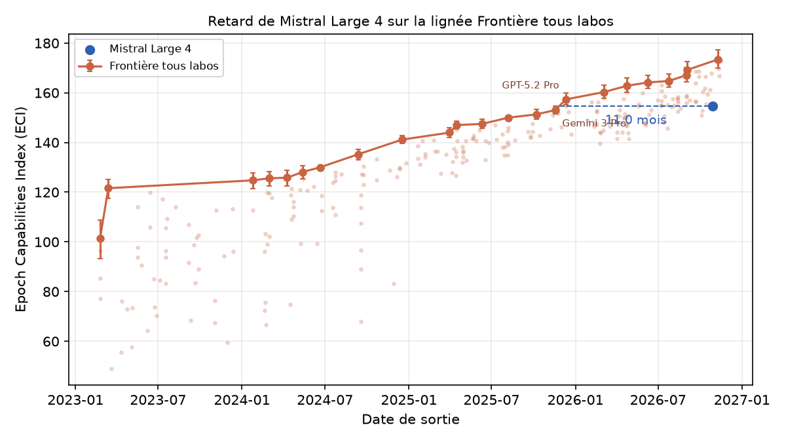

# benchlag

**How many months is one AI model behind another?**

**Try it in your browser: <https://vuillaut.github.io/benchlag/>** (nothing to install; the first load takes about 20 seconds).



## The idea in two minutes

Large language models (LLMs) such as Claude, GPT, Gemini, Mistral or Qwen come out in successive versions, each one usually better than the last. To compare them, researchers use **benchmarks**: fixed sets of tasks with an automatic score, such as graduate-level science questions ([GPQA](https://arxiv.org/abs/2311.12022)), competition maths problems, real programming tasks, or puzzles. Scores on these tests climb steadily over time.

A raw score difference is hard to interpret. "62% vs 71% on GPQA" doesn't tell most people much. A gap in **time** is easier to read: if the leading lab's models scored 62% back in March, a model scoring 62% in December is about nine months behind.

benchlag does this calculation. You pick a **target** model and a **reference** line of models (for example every version of Claude Opus). It finds the date at which the reference first reached the target's level and subtracts that date from the target's release date. The result is a lag in months.

### Example: Mistral Large 4

With Epoch AI data from 25 November 2026, on the composite index (ECI), with the 90% interval in brackets:

| Reference | Lag | Median over individual benchmarks |
|---|---:|---:|
| **All-labs frontier** (best model from anyone at each date; the default) | **11.0 months** (10.0 – 12.4) | 11.5 months (16 benchmarks) |
| Claude Opus line only | 9.7 months (7.1 – 11.0) | 8.9 months (15 benchmarks) |

Mistral Large 4 (released 29 October 2026) reached the level that the best models had in late November 2025, between Gemini 3 Pro and GPT-5.2 Pro. On the Claude Opus line, it sits between Opus 4.5 (November 2025) and Opus 4.6 (February 2026). Against Opus, the gap is small on agent and coding tasks (4–6 months) and large on factual knowledge and puzzles (around 15 months or more).

These figures change as new results come in. The site and [`reports/latest.md`](reports/latest.md) always show the latest numbers.

## How it works

The full protocol, with every rule and its rationale, is in [`PROTOCOLE.md`](PROTOCOLE.md) (in French). In short:

**Data.** Everything comes from the public benchmark hub of [Epoch AI](https://epoch.ai/benchmarks), a research organisation that tracks AI progress. Epoch runs many of these benchmarks itself, with the same setup for every model, so the numbers are not the labs' own marketing figures. For each model and benchmark, Epoch keeps the best published configuration (for example the highest "reasoning effort" setting).

**Method A: one composite score (main result).** Epoch combines dozens of benchmarks into a single number, the [Epoch Capabilities Index](https://epoch.ai/eci) (ECI). The scale is anchored so that Claude 3.5 Sonnet scores 130 and GPT-5 scores 150. benchlag:

1. takes the ECI of every version in the reference line, with its release date;
2. keeps only the **records**: the releases that beat the best score reached so far. A weaker later version does not make the line go backwards, and models released on the same day count as one point;
3. finds where the line through these records crosses the target's ECI, interpolating linearly in time between the last record below the target and the first one above it;
4. reports the lag as the target's release date minus that crossing date.

The uncertainty comes from repeating the calculation on the 500 resampled ("bootstrap") versions of the index that Epoch publishes. The report also gives the lag measured on real releases only, without interpolation: from the first record above the target, and from the last one below it.

Working with records treats a short line (9 versions of Claude Opus) and a dense one (every model from every lab, almost one per week) the same way.

**Method B: benchmark by benchmark (cross-check).** The same calculation runs on each individual benchmark the target was tested on. The median of these lags is compared with method A. This method also shows *where* the gap lies (knowledge, maths, code, agents). Benchmarks where the target is already near the maximum score are left out, because a fraction of a point there can be worth months.

**Guardrails.** benchlag measures a lag, not a lead. It refuses to give a number, with an explanation, in three cases:

- the target is ahead of every reference model;
- the reference only reached the target's level *after* the target came out;
- every reference model is better than the target but released after it, so no data point dates the crossing (for example GPT-6 Luna against GPT-6.2 Astra alone).

**Main limitations.** A gap of the same size counts as more or fewer months depending on how fast the reference was improving at that point. Some models have been tested on only a few benchmarks. Interpolating between two releases far apart in time gives a rough estimate, and the report flags these cases.

## Using benchlag

### In the browser

Open <https://vuillaut.github.io/benchlag/>. The sidebar sets the reference. The default is **the all-labs frontier**: the best model published by anyone at each date. You can also pick a preset line (Claude Opus, GPT, Gemini…), all models from one organisation, or your own name pattern. You can also add or remove reference models by hand. The page has two tabs:

- **Un modèle**: one model in detail, with the key figures, an interactive chart and the per-benchmark table (CSV export);
- **Comparer plusieurs modèles**: several models against the same reference, sorted by lag.

The interface is in French.

### On your computer

You need [uv](https://docs.astral.sh/uv/).

```sh
git clone https://github.com/vuillaut/benchlag.git
cd benchlag
uv run benchlag            # download the latest data and write the report to reports/
uv run benchlag --offline  # recompute from the last downloaded snapshot
uv run benchlag-ui         # same interface as the website, at http://localhost:8501
uv run pytest              # tests
```

Pick other models from the command line (names as Epoch writes them):

```sh
uv run benchlag --target "Kimi K3.1 Pro" --reference "^GPT-" --reference-label GPT
uv run benchlag --target "GLM-5.3" --reference-org Anthropic
```

Default settings (target, reference, thresholds) are in [`config.toml`](config.toml).

The report goes to `reports/`:

| File | Content |
|---|---|
| `latest.md` | readable report: result, per-benchmark table, reference trajectory |
| `eci_lag.png` | the chart above |
| `latest.json`, `per_benchmark.csv` | the same results, machine-readable |
| `history.csv` | one row per run, to follow how the answer changes over time |

## Automatic updates

The GitHub Actions workflow [`.github/workflows/update.yml`](.github/workflows/update.yml) runs on the 1st and 15th of each month at 05:00 UTC. It can also be started by hand from the Actions tab. Each run:

1. downloads the Epoch AI data;
2. recomputes the report;
3. runs the tests;
4. commits `reports/`;
5. rebuilds the website.

The website is a static page: [stlite](https://github.com/whitphx/stlite) runs the Streamlit app inside the browser with [Pyodide](https://pyodide.org/) (Python compiled to WebAssembly), so no server is needed. `uv run python scripts/build_site.py` builds it locally in `site/`.

To update a local copy without GitHub, put `scripts/update.sh` in a crontab (example in the script).

## Project layout

| Path | Role |
|---|---|
| `benchlag/lag.py` | the calculation: date matching, both methods, guardrails |
| `benchlag/fetch.py` | download and dated snapshot of the Epoch AI data |
| `benchlag/report.py` | Markdown report and chart |
| `benchlag/cli.py` | `benchlag` command |
| `benchlag/app.py` | Streamlit interface (local and website) |
| `scripts/build_site.py` | builds the static website |
| `PROTOCOLE.md` | full protocol (French) |

## Data and credit

Benchmark data: Epoch AI, ["Capabilities & benchmarking"](https://epoch.ai/benchmarks), under a [CC BY 4.0](https://creativecommons.org/licenses/by/4.0/) licence. The benchmarks belong to their authors. benchlag only reads Epoch's published results. It does not run any model.
