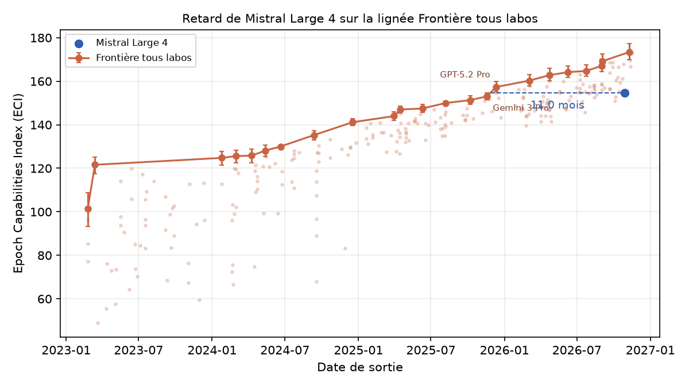

# Retard de Mistral Large 4 — référence : Frontière tous labos

Calculé le 2026-11-25 à partir de l'instantané Epoch AI `2026-11-25` (données sous licence CC BY 4.0, [epoch.ai/benchmarks](https://epoch.ai/benchmarks)).

## Résultat

- **Indice composite ECI** : Mistral Large 4 (2026-10-29) obtient 154.6. La référence « Frontière tous labos » a atteint ce niveau vers le **2025-11-26**, soit un retard de **11.0 mois** (IC 90 % : 10.0 à 12.4 mois, 500 tirages bootstrap).
  - En versions réelles : entre 10.6 mois (premier record de la référence au-dessus) et 11.3 mois (dernier record en dessous).
- **Benchmark par benchmark** : médiane 11.5 mois (IC 90 % : 10.3 à 14.6) sur 16 benchmarks.
  - Sur les seuls benchmarks bien encadrés (13) : médiane 11.4 mois (IC 90 % : 9.1 à 15.2).
  - Sans repli sur la preview (6 benchmarks) : médiane 15.4 mois (IC 90 % : 11.1 à 28.1).

## Détail par benchmark

Score cible = meilleure configuration publiée. *Retard* = date de sortie de la cible moins la date interpolée entre deux records de la référence (Frontière tous labos). *Bornes* = retard calculé sur le premier record au-dessus / le dernier en dessous.

| Benchmark | Variante cible | Score | Meilleur (Frontière tous labos) | Statut | Retard (mois) | Bornes | Retenu |
|---|---|---:|---:|---|---:|---|---|
| Mystery Game Puzzles | Mistral Large 4 | 0.119 | 0.945 | atteint | 30.1 | 18.4 – 40.5 | oui (encadrement 22 mois) |
| SimpleQA Verified | Mistral Large 4 | 0.224 | 0.940 | atteint | 28.1 | 26.7 – 32.0 | oui |
| Chess Puzzles | Mistral Large 4 | 0.253 | 0.779 | atteint | 19.3 | 18.4 – 20.9 | oui |
| LMCA | Mistral Large 4 Preview | 0.421 | 0.831 | atteint | 17.7 | 17.7 – 17.7 | oui |
| DTBench | Mistral Large 4 Preview | 0.804 | 0.987 | atteint | 15.2 | 14.0 – 15.9 | oui |
| ProofBench | Mistral Large 4 Preview | 0.100 | 1.000 | sous la 1re version | ≥ 14.0 | 14.0 – – | oui |
| FrontierMath-Tier-4-v2-Private | Mistral Large 4 Preview | 0.268 | 1.000 | atteint | 13.1 | 9.8 – 14.0 | oui |
| FrontierMath-Tiers-1-3-v2-Private | Mistral Large 4 Preview | 0.617 | 1.000 | atteint | 11.6 | 9.8 – 12.0 | oui |
| GPQA diamond | Mistral Large 4 | 0.905 | 0.998 | atteint | 11.4 | 11.3 – 11.5 | oui |
| Furniture Assembly | Mistral Large 4 | 0.012 | 0.857 | atteint | 11.1 | 10.6 – 11.1 | oui |
| EBR-bench | Mistral Large 4 | 0.181 | 0.924 | atteint | 10.9 | 10.6 – 11.1 | oui |
| Surface Evolver Bench | Mistral Large 4 Preview | 0.281 | 0.950 | atteint | 9.6 | 6.1 – 14.0 | oui (encadrement 8 mois) |
| WeirdML v3 | Mistral Large 4 Preview | 0.131 | 0.725 | atteint | 9.1 | 3.9 – 9.8 | oui |
| APEX-Agents | Mistral Large 4 Preview | 0.516 | 0.842 | atteint | 7.2 | 7.1 – 8.0 | oui |
| MirrorCode | Mistral Large 4 Preview | 0.400 | 0.978 | atteint | 6.4 | 5.7 – 8.0 | oui |
| OTIS Mock AIME 2024-2025 | Mistral Large 4 | 0.994 | 1.000 | atteint | 6.2 | 6.2 – 6.4 | non (saturé) |
| FrontierCode | Mistral Large 4 Preview | 0.394 | 0.546 | atteint | 5.6 | 5.5 – 5.7 | oui |

## Trajectoire ECI de la référence

| Modèle | Sortie | ECI | IC 90 % |
|---|---|---:|---|
| LLaMA-65B | 2023-02-24 | 101.5 | 93.2 – 108.9 |
| LLaMA-33B | 2023-02-24 | 96.5 | 87.4 – 104.5 |
| LLaMA-13B | 2023-02-24 | 85.2 | 73.4 – 95.4 |
| LLaMA-7B | 2023-02-24 | 77.3 | 63.4 – 88.9 |
| GPT-4 (Mar 2023) | 2023-03-14 | 121.6 | 117.6 – 125.2 |
| Cerebras-GPT-13B | 2023-03-20 | 48.9 | 26.2 – 67.1 |
| Dolly 2.0-12b | 2023-04-11 | 55.5 | 34.5 – 72.6 |
| vicuna-13b-v1.1 | 2023-04-12 | 76.1 | 60.8 – 88.6 |
| Falcon-7B | 2023-04-24 | 73.1 | 58.2 – 85.4 |
| RedPajama-INCITE-7B-Base | 2023-05-04 | 57.7 | 37.9 – 74.4 |
| MPT-7B | 2023-05-05 | 73.4 | 58.2 – 86.2 |
| PaLM 2-M | 2023-05-17 | 97.9 | 84.6 – 109.7 |
| PaLM 2-S | 2023-05-17 | 93.8 | 80.7 – 105.7 |
| PaLM 2-L | 2023-05-17 | 114.0 | 98.4 – 130.4 |
| Falcon-40B | 2023-05-25 | 90.7 | 80.0 – 100.0 |
| open_llama_7b | 2023-06-07 | 64.4 | 46.0 – 79.5 |
| GPT-3.5 Turbo (Jun 2023) | 2023-06-13 | 106.0 | 97.6 – 113.4 |
| GPT-4 (Jun 2023) | 2023-06-13 | 119.9 | 116.2 – 123.2 |
| MPT-30B | 2023-06-22 | 85.2 | 73.3 – 95.3 |
| chatglm2-6b | 2023-06-24 | 73.7 | 58.4 – 86.8 |
| XGen-7B | 2023-06-27 | 70.3 | 54.3 – 84.2 |
| internlm-7b | 2023-07-05 | 84.6 | 72.5 – 94.8 |
| Claude 2 | 2023-07-11 | 117.2 | 112.8 – 121.2 |
| Llama 2-13B | 2023-07-18 | 96.5 | 87.4 – 104.2 |
| Llama 2-70B | 2023-07-18 | 105.7 | 99.7 – 111.0 |
| Llama 2-34B | 2023-07-18 | 93.9 | 83.8 – 102.6 |
| Llama 2-7B | 2023-07-18 | 83.2 | 70.6 – 93.8 |
| Stable Beluga 2 | 2023-07-20 | 109.4 | 102.0 – 116.1 |
| Claude Instant | 2023-08-09 | 114.0 | 107.0 – 120.3 |
| Baichuan2-13B | 2023-09-06 | 91.8 | 80.8 – 100.9 |
| Falcon-180B | 2023-09-06 | 107.0 | 98.2 – 115.5 |
| Phi-1.5 | 2023-09-11 | 68.4 | 50.5 – 82.9 |
| internlm-20b | 2023-09-18 | 98.9 | 89.1 – 107.5 |
| Baichuan 2-7B | 2023-09-20 | 83.6 | 70.5 – 94.5 |
| Qwen-14B | 2023-09-24 | 101.8 | 93.2 – 109.3 |
| Mistral 7B v0.1 | 2023-09-27 | 102.7 | 94.9 – 109.1 |
| Qwen-7B | 2023-09-28 | 89.1 | 77.9 – 98.7 |
| DeepSeek Coder 33B | 2023-11-02 | 76.3 | 60.4 – 89.5 |
| DeepSeek Coder 6.7B | 2023-11-02 | 67.5 | 49.1 – 82.2 |
| GPT-3.5 Turbo (Nov 2023) | 2023-11-06 | 112.7 | 107.3 – 117.2 |
| Yi 6B | 2023-11-22 | 94.3 | 84.1 – 103.2 |
| Qwen-1_8B | 2023-11-30 | 59.6 | 40.2 – 75.7 |
| Mixtral 8x7B | 2023-12-11 | 113.2 | 108.1 – 117.5 |
| Phi-2 | 2023-12-12 | 96.2 | 86.9 – 104.2 |
| GPT-4 Turbo (Nov 2023) | 2024-01-25 | 124.8 | 121.5 – 127.7 |
| GPT-3.5 Turbo (Jan 2024) | 2024-01-25 | 112.9 | 107.8 – 117.3 |
| StarCoder 2 7B | 2024-02-20 | 72.4 | 54.9 – 86.6 |
| StarCoder 2 15B | 2024-02-20 | 96.1 | 84.0 – 106.0 |
| Gemma 2B | 2024-02-21 | 75.7 | 61.0 – 87.6 |
| Gemma 7B | 2024-02-21 | 103.2 | 95.4 – 109.7 |
| StarCoder 2 3B | 2024-02-22 | 66.6 | 47.9 – 81.7 |
| Mistral Large | 2024-02-26 | 120.0 | 115.9 – 123.6 |
| Nemotron-4 15B | 2024-02-26 | 99.1 | 90.0 – 107.0 |
| Claude 3 Sonnet | 2024-02-29 | 119.7 | 115.5 – 123.2 |
| Claude 3 Opus | 2024-02-29 | 125.6 | 122.5 – 128.3 |
| Yi-9B | 2024-03-01 | 102.2 | 91.3 – 111.8 |
| Claude 3 Haiku | 2024-03-07 | 117.8 | 113.5 – 121.5 |
| GPT-4 Turbo (Apr 2024) | 2024-04-09 | 125.8 | 122.5 – 128.8 |
| CodeQwen1.5-7B | 2024-04-15 | 74.8 | 57.5 – 88.6 |
| Mixtral 8x22B | 2024-04-17 | 118.7 | 114.5 – 122.5 |
| Llama 3-8B | 2024-04-18 | 109.1 | 103.4 – 114.0 |
| Llama 3-70B | 2024-04-18 | 121.3 | 117.5 – 124.7 |
| phi-3-mini 3.8B | 2024-04-23 | 110.5 | 104.0 – 116.1 |
| phi-3-small 7.4B | 2024-04-23 | 116.3 | 110.5 – 121.9 |
| phi-3-medium 14B | 2024-04-23 | 114.1 | 109.2 – 118.5 |
| DeepSeek-V2 (MoE-236B, May 2024) | 2024-05-07 | 120.8 | 114.0 – 127.6 |
| Falcon 2 11B | 2024-05-09 | 99.2 | 88.4 – 109.0 |
| GPT-4o (May 2024) | 2024-05-13 | 128.1 | 125.4 – 130.7 |
| Gemini 1.5 Pro (May 2024) | 2024-05-14 | 125.4 | 122.1 – 128.3 |
| Gemini 1.5 Flash (May 2024) | 2024-05-23 | 120.6 | 116.7 – 124.1 |
| Qwen2-72B | 2024-06-07 | 122.3 | 118.6 – 125.6 |
| DeepSeek-Coder-V2-Lite-Base | 2024-06-13 | 99.4 | 88.8 – 108.4 |
| Claude 3.5 Sonnet | 2024-06-20 | 130.0 | nan – nan |
| Gemma 2 27B | 2024-06-24 | 118.6 | 114.2 – 122.4 |
| Gemma 2 9B | 2024-06-24 | 112.4 | 106.8 – 117.3 |
| Mistral NeMo | 2024-07-18 | 113.9 | 108.6 – 118.4 |
| GPT-4o mini | 2024-07-18 | 123.8 | 120.5 – 126.8 |
| Llama 3.1-405B | 2024-07-23 | 127.9 | 125.0 – 130.5 |
| Llama 3.1-70B | 2024-07-23 | 124.7 | 121.4 – 127.7 |
| Llama 3.1-8B | 2024-07-23 | 110.9 | 105.1 – 115.9 |
| Mistral Large 2 (Jul 2024) | 2024-07-24 | 126.4 | 123.1 – 129.4 |
| GPT-4o (Aug 2024) | 2024-08-06 | 127.2 | 124.1 – 129.9 |
| o1-preview | 2024-09-12 | 133.6 | 131.1 – 135.9 |
| o1-mini | 2024-09-12 | 135.3 | 133.0 – 137.3 |
| Qwen2.5-Coder-0.5B | 2024-09-18 | 68.1 | 48.4 – 83.9 |
| Qwen2.5-Coder (1.5B) | 2024-09-18 | 89.1 | 76.0 – 100.1 |
| Qwen2.5-Coder-14B | 2024-09-18 | 113.7 | 105.2 – 122.3 |
| Qwen2.5-Coder-32B | 2024-09-18 | 118.7 | 109.5 – 127.8 |
| Qwen2.5-Coder (7B) | 2024-09-18 | 107.4 | 97.7 – 116.1 |
| Qwen2.5-Coder-3B | 2024-09-18 | 96.8 | 82.9 – 109.1 |
| Qwen2.5-72B | 2024-09-19 | 127.2 | 124.4 – 129.8 |
| Gemini 1.5 Flash (Sep 2024) | 2024-09-24 | 127.0 | 123.8 – 129.9 |
| Gemini 1.5 Pro (Sept 2024) | 2024-09-24 | 130.4 | 127.8 – 132.8 |
| Llama 3.2 90B | 2024-09-24 | 122.9 | 119.2 – 126.3 |
| Claude 3.5 Haiku | 2024-10-22 | 124.8 | 121.5 – 127.7 |
| Claude 3.5 Sonnet (October 2024) | 2024-10-22 | 133.4 | 131.2 – 135.5 |
| GPT-4o (Nov 2024) | 2024-11-20 | 128.8 | 126.1 – 131.2 |
| INTELLECT-1 | 2024-11-29 | 83.3 | 70.8 – 94.0 |
| Llama 3.3 70B | 2024-12-06 | 126.2 | 123.0 – 129.0 |
| Phi-4 | 2024-12-12 | 129.2 | 126.1 – 132.0 |
| Grok-2 (Dec 2024) | 2024-12-12 | 129.8 | 127.0 – 132.3 |
| o1 | 2024-12-17 | 141.2 | 139.5 – 142.8 |
| DeepSeek-V3 | 2024-12-26 | 131.7 | 129.2 – 134.0 |
| DeepSeek-R1 | 2025-01-20 | 138.6 | 136.6 – 140.5 |
| Gemini 2.0 Flash Thinking (Jan 2025) | 2025-01-21 | 133.6 | 130.7 – 136.4 |
| Qwen2.5-Max | 2025-01-25 | 131.2 | 128.4 – 133.7 |
| o3-mini | 2025-01-31 | 140.6 | 138.9 – 142.2 |
| Gemini 2.0 Flash (Feb 2025) | 2025-02-05 | 134.0 | 131.7 – 136.2 |
| Gemini 2.0 Pro | 2025-02-05 | 135.4 | 132.6 – 138.0 |
| Claude 3.7 Sonnet | 2025-02-24 | 141.0 | 139.4 – 142.6 |
| GPT-4.5 | 2025-02-27 | 136.5 | 134.4 – 138.4 |
| QwQ-32B | 2025-03-05 | 136.4 | 133.7 – 139.1 |
| Gemma 3 27B | 2025-03-12 | 127.6 | 124.4 – 130.4 |
| DeepSeek-V3 (Mar 2025) | 2025-03-24 | 135.2 | 133.0 – 137.4 |
| Gemini 2.5 Pro (Mar 2025) | 2025-03-31 | 144.0 | 142.0 – 145.9 |
| Llama 4 Scout | 2025-04-05 | 127.8 | 124.9 – 130.3 |
| Llama 4 Maverick | 2025-04-06 | 132.2 | 129.8 – 134.3 |
| Grok 3 | 2025-04-09 | 137.6 | 135.6 – 139.4 |
| GPT-4.1 mini | 2025-04-14 | 134.2 | 132.1 – 136.2 |
| GPT-4.1 | 2025-04-14 | 136.1 | 134.2 – 138.0 |
| GPT-4.1 nano | 2025-04-14 | 126.8 | 123.8 – 129.5 |
| o3 | 2025-04-16 | 147.0 | 145.5 – 148.6 |
| o4-mini | 2025-04-16 | 145.2 | 143.7 – 146.7 |
| Gemini 2.5 Flash (Apr 2025) | 2025-04-17 | 140.7 | 138.3 – 142.9 |
| Qwen3-235B-A22B | 2025-04-28 | 138.4 | 136.0 – 140.7 |
| Qwen3-8B | 2025-04-28 | 132.1 | 128.9 – 134.9 |
| Qwen3-14B | 2025-04-29 | 136.1 | 133.3 – 138.7 |
| Qwen3-30B-A3B | 2025-04-29 | 134.2 | 131.3 – 136.7 |
| Qwen3-32B | 2025-04-29 | 136.8 | 134.4 – 139.1 |
| Gemini 2.5 Pro (May 2025) | 2025-05-06 | 140.6 | 138.3 – 143.0 |
| Mistral Medium 3 | 2025-05-07 | 132.8 | 130.1 – 135.3 |
| Gemini 2.5 Flash (May 2025) | 2025-05-20 | 141.6 | 139.4 – 143.6 |
| Claude Opus 4 | 2025-05-22 | 142.8 | 141.3 – 144.4 |
| Claude Sonnet 4 | 2025-05-22 | 141.8 | 140.3 – 143.3 |
| DeepSeek-R1 (May 2025) | 2025-05-28 | 140.7 | 138.9 – 142.4 |
| Gemini 2.5 Pro (Jun 2025) | 2025-06-05 | 144.9 | 143.5 – 146.3 |
| o3-pro | 2025-06-10 | 147.5 | 145.7 – 149.4 |
| Gemini 2.5 Flash-Lite (Jun 2025) | 2025-06-17 | 133.0 | 129.2 – 136.7 |
| Gemini 2.5 Flash (Jun 2025) | 2025-06-17 | 140.8 | 138.3 – 143.1 |
| Grok-3 mini | 2025-06-24 | 139.9 | 138.0 – 141.7 |
| Grok 4 | 2025-07-09 | 146.9 | 145.4 – 148.4 |
| Kimi K2 (Jul 2025) | 2025-07-12 | 141.3 | 138.4 – 143.9 |
| Qwen3-235B-A22B-Thinking (Jul 2025) | 2025-07-25 | 143.2 | 141.3 – 145.1 |
| Qwen3-235B-A22B-Instruct (Jul 2025) | 2025-07-25 | 138.0 | 135.7 – 140.2 |
| Qwen3-30B-A3B-Instruct (Jul 2025) | 2025-07-29 | 134.9 | 131.9 – 137.7 |
| Qwen3-30B-A3B-Thinking (Jul 2025) | 2025-07-30 | 138.3 | 135.8 – 140.8 |
| gpt-oss-20b | 2025-08-05 | 134.9 | 132.3 – 137.3 |
| Claude Opus 4.1 | 2025-08-05 | 144.8 | 143.0 – 146.5 |
| gpt-oss-120b | 2025-08-05 | 140.2 | 138.3 – 142.0 |
| GPT-5 nano | 2025-08-07 | 139.1 | 137.1 – 140.9 |
| GPT-5 | 2025-08-07 | 150.0 | nan – nan |
| GPT-5 mini | 2025-08-07 | 146.0 | 144.5 – 147.6 |
| DeepSeek-V3.1 | 2025-08-21 | 140.9 | 137.7 – 144.0 |
| Grok 4 Fast | 2025-09-19 | 144.3 | 142.2 – 146.4 |
| Qwen3-Max | 2025-09-24 | 142.4 | 140.4 – 144.5 |
| Gemini 2.5 Flash (Sep 2025) | 2025-09-25 | 141.9 | 139.2 – 144.4 |
| DeepSeek-V3.2-Exp | 2025-09-29 | 144.4 | 142.2 – 146.7 |
| Claude Sonnet 4.5 | 2025-09-29 | 147.6 | 146.1 – 149.1 |
| GPT-5 Pro | 2025-10-07 | 151.3 | 149.4 – 153.3 |
| Claude Haiku 4.5 | 2025-10-15 | 142.7 | 141.0 – 144.4 |
| Kimi K2 Thinking | 2025-11-06 | 145.5 | 143.7 – 147.3 |
| GPT-5.1 | 2025-11-13 | 150.9 | 149.3 – 152.6 |
| Gemini 3 Pro | 2025-11-18 | 153.0 | 151.5 – 154.8 |
| Claude Opus 4.5 | 2025-11-24 | 151.9 | 150.3 – 153.4 |
| DeepSeek-V3.2 | 2025-12-01 | 146.3 | 144.7 – 147.8 |
| GPT-5.2 | 2025-12-11 | 154.5 | 152.9 – 156.3 |
| GPT-5.2 Pro | 2025-12-11 | 157.3 | 155.1 – 159.9 |
| Gemini 3 Flash | 2025-12-17 | 152.3 | 150.8 – 154.1 |
| GLM-4.7 | 2025-12-22 | 143.3 | 141.4 – 145.3 |
| Kimi K2.5 | 2026-01-27 | 148.8 | 147.3 – 150.3 |
| Claude Opus 4.6 | 2026-02-05 | 156.3 | 154.6 – 158.3 |
| GLM-5 | 2026-02-11 | 146.5 | 144.9 – 148.1 |
| Qwen3.5 397B-A17B | 2026-02-13 | 148.0 | 145.9 – 150.1 |
| Qwen 3.5 Plus (hosted 397B-A17B) | 2026-02-16 | 147.3 | 145.4 – 149.2 |
| Claude Sonnet 4.6 | 2026-02-17 | 152.8 | 151.2 – 154.5 |
| Grok 4.20 | 2026-02-17 | 152.3 | 150.5 – 154.1 |
| Gemini 3.1 Pro | 2026-02-19 | 156.2 | 154.5 – 158.2 |
| Qwen3.5-35B-A3B | 2026-02-24 | 144.1 | 141.5 – 146.6 |
| Qwen3.5-9B | 2026-02-24 | 139.5 | 137.3 – 141.7 |
| Qwen 3.5 Flash (hosted 35B-A3B) | 2026-02-25 | 143.8 | 141.9 – 145.7 |
| Gemini 3.1 Flash-Lite | 2026-03-03 | 145.0 | 142.8 – 147.1 |
| GPT-5.4 | 2026-03-05 | 157.9 | 156.0 – 160.0 |
| GPT-5.4 Pro | 2026-03-05 | 160.3 | 157.9 – 163.0 |
| GPT-5.4 Mini | 2026-03-17 | 149.4 | 147.7 – 151.1 |
| GPT-5.4 Nano | 2026-03-17 | 146.4 | 144.7 – 148.0 |
| Qwen 3.6 Plus | 2026-03-31 | 148.9 | 146.8 – 150.9 |
| Gemma 4 26B A4B | 2026-04-02 | 141.6 | 139.1 – 143.9 |
| Gemma 4 31B IT | 2026-04-02 | 144.1 | 141.7 – 146.6 |
| GLM-5.1 | 2026-04-07 | 150.7 | 148.7 – 152.8 |
| Muse Spark | 2026-04-08 | 153.2 | 150.9 – 155.5 |
| Qwen 3.6 35B-A3B | 2026-04-14 | 144.1 | 142.2 – 145.9 |
| Claude Opus 4.7 | 2026-04-16 | 157.5 | 155.6 – 159.6 |
| Grok 4.3 Beta | 2026-04-17 | 149.9 | 148.0 – 151.9 |
| Kimi K2.6 | 2026-04-20 | 151.6 | 149.9 – 153.4 |
| Qwen 3.6 Max (Preview) | 2026-04-20 | 149.9 | 147.9 – 151.9 |
| Qwen3.6 27B | 2026-04-22 | 146.7 | 144.6 – 148.9 |
| GPT-5.5 Pro | 2026-04-23 | 162.8 | 160.1 – 165.9 |
| GPT-5.5 | 2026-04-23 | 160.2 | 158.2 – 162.4 |
| DeepSeek-V4-Flash | 2026-04-24 | 146.9 | 143.7 – 150.2 |
| DeepSeek-V4-Pro | 2026-04-24 | 150.2 | 148.4 – 152.0 |
| Qwen 3.6 Flash | 2026-04-27 | 143.7 | 141.8 – 145.6 |
| Mistral Medium 3.5 | 2026-04-28 | 141.6 | 138.3 – 144.7 |
| Qwen3.7-Max | 2026-05-19 | 154.6 | 152.6 – 156.8 |
| Gemini 3.5 Flash | 2026-05-19 | 155.3 | 153.5 – 157.3 |
| Claude Opus 4.8 | 2026-05-28 | 159.9 | 157.8 – 162.2 |
| MiniMax-M3 | 2026-06-01 | 147.8 | 145.7 – 150.0 |
| Qwen3.7-Plus | 2026-06-02 | 147.9 | 146.0 – 150.0 |
| Nemotron 3 Ultra | 2026-06-04 | 147.0 | 144.9 – 149.2 |
| Claude Fable 5 | 2026-06-09 | 164.2 | 161.8 – 166.9 |
| Kimi K2.7 Code | 2026-06-12 | 151.2 | 149.2 – 153.2 |
| GLM-5.2 | 2026-06-16 | 153.1 | 151.3 – 154.9 |
| Claude Sonnet 5 | 2026-06-30 | 156.9 | 154.9 – 159.1 |
| Grok 4.5 | 2026-07-08 | 155.0 | 153.1 – 156.9 |
| Muse Spark 1.1 | 2026-07-09 | 154.9 | 152.4 – 157.7 |
| GPT-5.6 Sol | 2026-07-09 | 163.0 | 160.7 – 165.6 |
| GPT-5.6 Luna | 2026-07-09 | 156.7 | 154.9 – 158.8 |
| GPT-5.6 Terra | 2026-07-09 | 160.8 | 158.5 – 163.3 |
| Inkling-Small | 2026-07-15 | 150.8 | 149.0 – 152.5 |
| Inkling | 2026-07-15 | 148.4 | 146.8 – 150.1 |
| Kimi K3 | 2026-07-16 | 158.6 | 156.7 – 160.8 |
| Gemini 3.5 Flash-Lite | 2026-07-21 | 145.6 | 144.0 – 147.2 |
| Gemini 3.6 Flash | 2026-07-21 | 155.2 | 153.4 – 157.3 |
| Claude Opus 5 | 2026-07-24 | 164.7 | 162.3 – 167.5 |
| DeepSeek V4 Flash 0731 | 2026-07-31 | 154.4 | 152.6 – 156.4 |
| Qwen 3.8 Max | 2026-08-02 | 157.6 | 155.5 – 159.8 |
| Muse Spark 1.2 | 2026-08-05 | 155.0 | 152.7 – 157.5 |
| Grok 4.6 | 2026-08-12 | 157.8 | 155.9 – 160.0 |
| Gemini 3.7 Flash | 2026-08-13 | 158.4 | 156.5 – 160.6 |
| DeepSeek V4 Pro 0813 | 2026-08-13 | 156.0 | 154.1 – 158.1 |
| GLM-5.3 | 2026-08-14 | 157.1 | 155.0 – 159.4 |
| Qwen 3.8 27B | 2026-08-14 | 152.6 | 150.7 – 154.7 |
| GLM-5.3-Flash | 2026-08-20 | 153.8 | 151.9 – 155.8 |
| Qwen3.8 Max (0902) | 2026-09-01 | 156.0 | 153.9 – 158.3 |
| Claude Fable 5.1 | 2026-09-01 | 167.1 | 164.4 – 170.1 |
| Muse Spark 1.3 | 2026-09-02 | 158.2 | 156.2 – 160.5 |
| Gemini 3.8 Flash | 2026-09-02 | 158.8 | 156.8 – 161.0 |
| GPT-6 Astra | 2026-09-03 | 169.2 | 166.4 – 172.5 |
| DeepSeek V4.1 Flash | 2026-09-09 | 157.0 | 155.1 – 159.2 |
| Grok 4.7 | 2026-09-21 | 156.4 | 154.5 – 158.5 |
| GPT-6 Sol | 2026-09-22 | 163.8 | 161.4 – 166.6 |
| GPT-6 Luna | 2026-09-22 | 156.4 | 154.6 – 158.5 |
| Claude Opus 5.5 | 2026-09-22 | 168.7 | 165.9 – 172.0 |
| Claude Sonnet 5.5 | 2026-09-28 | 166.6 | 163.9 – 169.6 |
| GPT-6.1 Sol | 2026-09-29 | 168.6 | 165.7 – 171.9 |
| Beam 1.0 | 2026-10-05 | 150.8 | 148.6 – 153.1 |
| Mistral Large 4 Preview | 2026-10-06 | 152.7 | 150.8 – 154.7 |
| Claude Haiku 5.5 | 2026-10-07 | 160.3 | 158.2 – 162.7 |
| Muse Wonder | 2026-10-12 | 161.7 | 159.4 – 164.3 |
| Gemini 4 Argon | 2026-10-13 | 166.5 | 163.9 – 169.5 |
| Muse Spark Open | 2026-10-15 | 155.5 | 153.3 – 157.8 |
| DeepSeek V4.1 Flash 1017 | 2026-10-17 | 159.4 | 157.1 – 161.9 |
| Kimi K3.1 Pro | 2026-10-23 | 161.2 | 158.9 – 163.7 |
| GPT-6.1 Terra | 2026-10-26 | 167.7 | 164.9 – 171.0 |
| Claude Fable 5.2 | 2026-11-09 | 173.4 | 170.0 – 177.2 |
| Gemini 4 Carbon | 2026-11-10 | 169.7 | 166.6 – 173.1 |
| Gemini 4 Hydrogen | 2026-11-12 | 166.8 | 164.0 – 170.1 |
| GPT-6.2 Astra | 2026-11-17 | 172.8 | 169.4 – 176.9 |

Méthode complète : voir `PROTOCOLE.md`.
